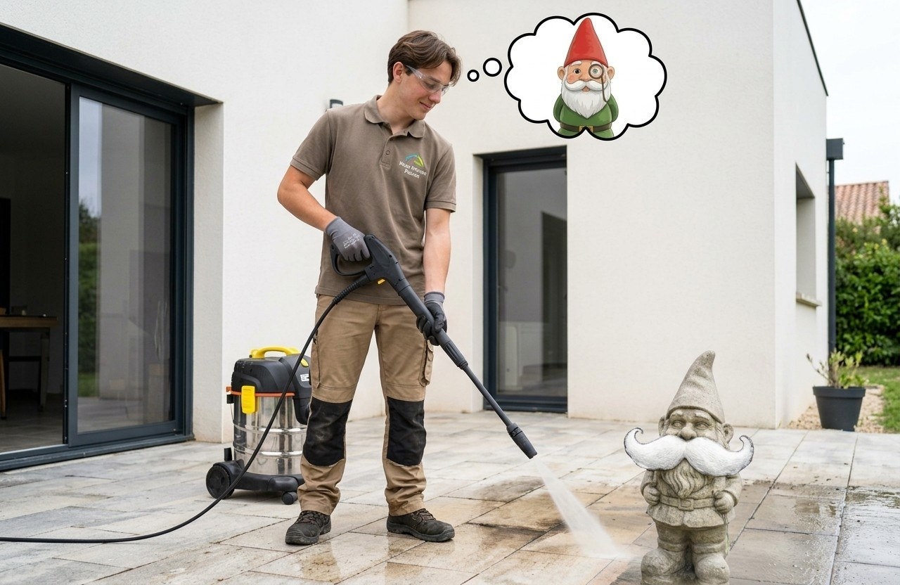

# Contexte du projet

> À lire avant de travailler sur sa page. Tout ce qui est ici est **inventé** pour le projet.

## L'entreprise

**Elouan Ménage**, *« Un seul pro pour toute la maison. »*

Elouan est le visage de l'entreprise. Il intervient chez les particuliers pour **entretenir, nettoyer et jardiner**, et il est **multi-tâches** : un seul passage d'Elouan, et la maison comme le jardin sont réglés. Il n'y a pas besoin d'appeler trois prestataires différents.

- **Création :** 2021, en auto-entrepreneur (date inventée).
- **Zone d'intervention :** une ville moyenne et ses alentours, dans un rayon de 20 km (à préciser ensemble si besoin).
- **Clients :** particuliers, familles actives, personnes âgées, propriétaires de résidences secondaires ou de locations saisonnières.
- **Valeurs :** fiabilité, polyvalence, proximité et soin du détail.

## Les services

| Pôle | Exemples de prestations |
|---|---|
| **Entretien** | Ménage régulier, repassage, rangement, entretien entre deux locations |
| **Nettoyage** | Grand nettoyage, vitres, fin de chantier, état des lieux d'entrée et de sortie |
| **Jardinage** | Tonte, taille de haies, désherbage, ramassage de feuilles, entretien des massifs |
| **Petits coups de main** | Montage de meubles, petites réparations, sortie des poubelles, surveillance pendant les vacances |

Argument clé : **un seul interlocuteur, un seul créneau, plusieurs tâches.**

## Le ton

- Le site **vouvoie** le client, sur un ton chaleureux et simple, jamais froid ni corporate.
- Les phrases sont courtes et concrètes. On parle de résultats : « une maison propre en rentrant du travail ».
- Elouan parle à la première personne dans les citations, par exemple : « Je m'occupe de tout, vous profitez. »

## Le rôle de chaque page

### Accueil (Rachel, `index.html`)
- Une grande accroche avec le slogan et un bouton **« Demander un devis »**.
- Les 4 pôles de services, présentés en 4 cartes.
- Un court aperçu de l'histoire (lien vers *Notre histoire*), des tarifs (lien vers *Tarifs*) et 2 ou 3 avis (lien vers *Avis*).

### Notre histoire (Edgar, `notre-histoire.html`)
- Qui est Elouan, pourquoi il a lancé l'entreprise et pourquoi il est multi-tâches.
- Les valeurs de l'entreprise.
- Une petite frise chronologique, par exemple : 2021 création, 2023 ajout du jardinage, 2025 100e client.

### Tarifs (Elouan, `tarifs.html`)
Prix indicatifs inventés, à ajuster :

| Prestation | Prix |
|---|---|
| Ménage / entretien | 30 € / h |
| Jardinage | 35 € / h |
| Grand nettoyage | à partir de 150 € |
| **Forfait « Maison complète »** (ménage + jardin, 4 h) | 120 € |

- Mentionner **l'avance immédiate de crédit d'impôt de 50 %** pour les services à la personne : le client ne paie que la moitié.
- Terminer par un bouton **« Demander un devis »**.

### Avis (Jules, `avis.html`)
- 6 à 8 témoignages inventés, avec prénom, ville, note sur 5 et service concerné.
- La note moyenne affichée en haut, par exemple **4,9 / 5**.
- Varier les services cités pour montrer la polyvalence d'Elouan.

## Les photos

Elouan porte toujours sa tenue de travail : polo taupe avec le logo, pantalon de travail beige. Un **clin d'œil humoristique** est caché dans chaque photo, c'est la signature de l'entreprise.

**Chaque photo n'est utilisée que sur UNE page.** Pas de doublon : n'utilisez pas la photo d'un autre.

| Page | Responsable | Photo (dossier `images/`) | Ce qu'on voit | Clin d'œil |
|---|---|---|---|---|
| Accueil | Rachel | `accueil-terrasse-nain.jpg` | Nettoyage de terrasse au nettoyeur haute pression | Un nain de jardin à moustache, et Elouan qui rêve d'un nain à monocle |
| Notre histoire | Edgar | `histoire-vitres-sourire.jpg` | Lavage de vitres à la raclette | Un smiley et des yeux dessinés dans la buée |
| Tarifs | Elouan | `tarifs-aspirateur-salon.jpg` | Aspirateur dans un salon lumineux | Une perruche dans un nid sur l'aspirateur, un portrait moustachu au mur |
| Avis | Jules | `avis-haie-pouce.jpg` | Taille de haie au sécateur | Une haie taillée en pouce levé 👍, et une coccinelle |

Pourquoi ce choix :
- **Accueil :** c'est la photo la plus grande et la plus nette, idéale pour le bandeau d'accroche.
- **Histoire :** Elouan au travail, de près, pour montrer la personne.
- **Tarifs :** le ménage intérieur est la prestation la plus demandée.
- **Avis :** le pouce levé dit « clients satisfaits ».

Utilisation dans le code :

```html

```

## Coordonnées (fictives)

- Téléphone : 06 00 00 00 00
- E-mail : contact@elouan-menage.fr
- Horaires : du lundi au samedi, de 8 h à 19 h

Le design commun est décrit dans [CHARTE.md](CHARTE.md).
